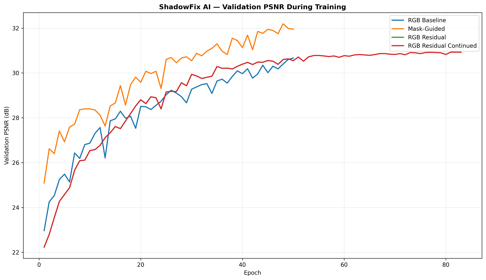
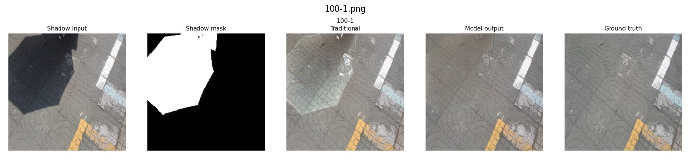

# ShadowFix: Shadow Removal from Real-World Images

ShadowFix removes shadows from photos with a U-Net trained in PyTorch on the ISTD benchmark, and wraps the model in a Gradio app with an **Automatic** mode and a **Guided** (paint-the-shadow) mode.

Capstone project for the MS in Computer Science (AI & ML) at the University at Buffalo, Summer 2026, built by Odra Bira, Pranay Lachuluri and Rohith Bharadwaj.



## Results

Held-out ISTD test split (540 images, 256×256):

| Method | PSNR (dB) | SSIM | Shadow PSNR | Non-shadow PSNR |
| --- | --- | --- | --- | --- |
| Shadow input (no correction) | 20.56 | 0.910 | 13.41 | 26.48 |
| Traditional illumination correction | 24.70 | 0.934 | 21.52 | 25.94 |
| RGB U-Net baseline | 27.18 | 0.932 | 24.10 | 28.55 |
| RGB residual U-Net (50 epochs) | 26.59 | 0.927 | 25.06 | 27.22 |
| RGB residual U-Net (continued training) | 26.43 | 0.927 | 25.03 | 27.04 |
| **Mask-guided U-Net** | **30.19** | **0.951** | **26.30** | **31.89** |

- The mask-guided U-Net is best on every metric: **+9.63 dB** over the raw shadow input, **+5.49 dB** over traditional correction and **+3.01 dB** over the RGB baseline.
- The residual variants restore shadow regions better than the baseline (+1 dB shadow PSNR) but alter non-shadow pixels more, so their overall PSNR is lower.
- The U-Net has about **7.76M parameters** and was trained on a Colab Tesla T4 with mixed precision.

Full numbers are in [`results/model_comparison.csv`](results/model_comparison.csv) and the charts in [`results/figures`](results/figures).

### Example (ISTD test image)

Shadow input, ground-truth mask, traditional correction, model output and ground truth:



## How it works

1. **Data**: ISTD triplets of shadow image, binary shadow mask and shadow-free target. 1,330 training triplets (split 1,197 train / 133 validation) and 540 test triplets, resized to 256×256.
2. **Models**: a U-Net (encoder–decoder with skip connections, base width 32) in three settings:
   - *RGB baseline*: shadow image in, shadow-free image out.
   - *RGB residual*: predicts a correction that is added to the input image.
   - *Mask-guided*: the shadow mask is a 4th input channel so the network knows where to correct.
3. **Loss**: L1 reconstruction with separate weights for shadow and non-shadow pixels (shadow weight 4–6), plus an edge term for the later runs.
4. **Evaluation**: overall PSNR and SSIM, plus PSNR computed separately inside and outside the shadow mask, against a hand-crafted illumination-correction baseline.
5. **App**: a Gradio interface ([`app/shadowfix_app.py`](app/shadowfix_app.py)):
   - *Automatic mode* runs the RGB model on the whole image and shows an estimated shadow map (LAB lightness vs. local mean, cleaned with morphology), shadow coverage and severity.
   - *Guided mode* lets the user paint the shadow; the restoration is blended into that region with Natural (55%), Balanced (80%), Strong (100%) or custom strength.
   - Both modes include a before/after slider and a download button.

## Repository layout

| Path | Contents |
| --- | --- |
| `notebooks/shadow_removal_colab.ipynb` | End-to-end Colab run: dataset download and checks, training all model variants, evaluation, charts and the Gradio app, with outputs |
| `app/shadowfix_app.py` | Standalone version of the Gradio app |
| `results/` | Metrics table, comparison charts and sample outputs |
| `requirements.txt` | Python dependencies |

## Running it

The notebook is written for Google Colab with a GPU runtime. It expects the training package (`train.py`, `evaluate.py`, `inference.py`, `download_istd.py`) in `/content/shadow_removal_project` and stores checkpoints in Google Drive. Run the cells top to bottom.

Training commands used for the final models:

```bash
# RGB baseline
python train.py --data-root data --output-dir runs/baseline --image-size 256 \
  --batch-size 8 --epochs 50 --learning-rate 2e-4 --base-channels 32 \
  --shadow-weight 1 --nonshadow-weight 1 --amp

# Mask-guided U-Net (best model)
python train.py --data-root data --output-dir runs/mask_guided --image-size 256 \
  --batch-size 8 --epochs 50 --learning-rate 2e-4 --base-channels 32 \
  --use-mask-input --shadow-weight 4 --nonshadow-weight 1 --edge-weight 0.05 --amp

# Evaluate against the shadow input and the traditional baseline
python evaluate.py --data-root data --checkpoint runs/mask_guided/best.pth \
  --output-dir evaluation/mask_guided --num-visuals 20 --include-traditional
```

Launch the app locally once you have a checkpoint:

```bash
pip install -r requirements.txt
python app/shadowfix_app.py --project-dir path/to/shadow_removal_project \
  --checkpoint runs/baseline_final/best.pth
```

Checkpoints (~89 MB each) are not stored in this repository.

## Limitations

- Training at 256×256 loses some fine texture on high-resolution photos.
- The mask-guided model needs a good mask; painted or estimated masks are less accurate than ISTD ground truth, which is why the app uses the RGB model with guided blending.
- Phone and internet photos differ from ISTD in lighting and surfaces, so some shadows remain visible on out-of-distribution images.
- PSNR and SSIM do not fully capture perceptual quality; LPIPS or a user study would be a useful next step.

## Team

- **Odra Bira**: integration, notebook runs, evaluation, interface testing, charts, report and presentation
- **Pranay Lachuluri**: dataset preparation, model training experiments, checkpoint management, Colab/Drive workflow debugging
- **Rohith Bharadwaj**: evaluation design, comparison analysis, Gradio testing, qualitative results, documentation review

## References

- O. Ronneberger, P. Fischer, T. Brox. *U-Net: Convolutional Networks for Biomedical Image Segmentation.* MICCAI 2015.
- J. Wang, X. Li, J. Yang. *Stacked Conditional GANs for Jointly Learning Shadow Detection and Shadow Removal* (ISTD dataset). CVPR 2018.
